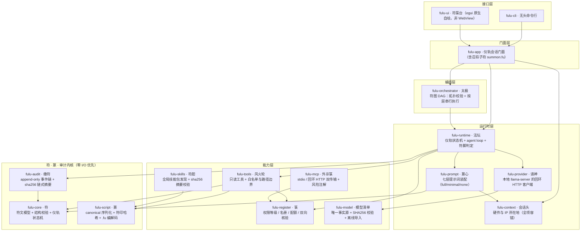
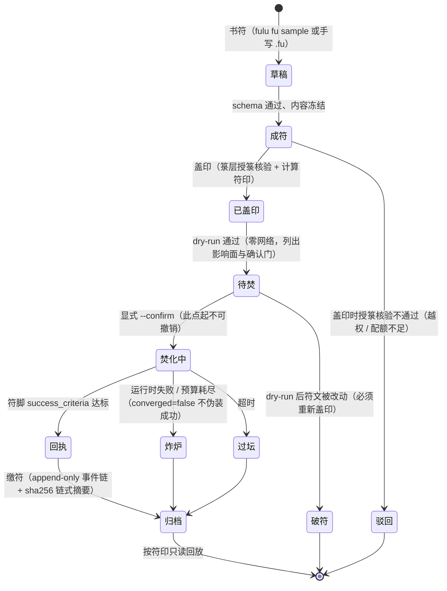
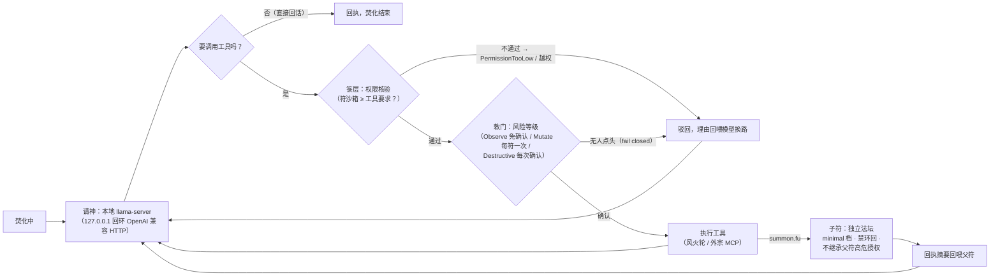

# taoism-agent

项目名与仓库名均为 `taoism-agent`（与本地目录一致）；代号 **符箓**。

> **每个提示词就是一张符。** 原创的 Rust Agent 系统：以道教符、箓、篆体系为信息架构与运行流程，把提示词做成可校验、可签名、可回放的「符文」；用「箓」管授权与工具名册，用「篆」管编码与书写，用「法坛」执行，用「太极」编排，用「缴符」归档。UI 与数据同构——界面本身就是一张符。

**当前状态：M3 进行中（外宗接法坛 + 符箓台 + 外宗逐工具分级已完成）。** 仓库已有 16 个 crate 的 workspace、CI、符文领域模型、箓层授权（含双向权限核验）、风火轮工具（含敕行分 OS 命令行）、法坛状态机、缴符事件链、内置模型清单与合规闸门、本地 `llama-server` 的 OpenAI 兼容 HTTP 实现、会话头采集、分层提示词装配、全局 MCP 与技能包发现。**M3 本轮新增：外宗工具真正进入焚符循环（stdio 与回环 HTTP 双传输，真实子进程 + 真实 TCP 端到端测试）、符箓台三栏 GUI（符箓／法坛／缴符，焚符走后台线程）、外宗逐工具分级与「敕门」（破坏性召将未获确认一律敕否，可 `--allow-risk` 预授权或 `--ask` 逐次问人）**。**S1 补齐断链（会话头与七层提示词真正进焚符循环、符胆摘要重校验、覆盖表写入）；S2 太极符图编排最小可用版（DAG 拓扑校验 + 按层串行执行 + `fulu taiji run`）与召将子符（`summon.fu`：独立法坛 + minimal 档 + 禁环回 + 不继承父符高危授权）**。本机真实接上了本机唯一的 `streamable-http` MCP server 并列出 9 个工具。**真实 LFM 权重仍未下载、未做真机推理**；中文 IME 人工验收已在 Windows 10 22H2 + 百度输入法 + 100% 缩放下**通过 10 条 P0**（[记录](docs/acceptance/2026-11-11-windows10.md)，口头逐条确认、无截图），macOS / Linux 的 IME 未测；三平台窗口与符纸视觉仍未验收（[清单](docs/04-真人验收清单.md)）。

## 系统架构

分层自上而下单向依赖（上层可用下层，下层绝不知上层），接口层（CLI / GUI）可整体替换：



要点：**敕门在能力层与运行时之间**——`fulu-register` 回答「这张符最多能碰什么」（权限，静态），风险等级回答「碰之前要不要人点头」（逐次），两维正交不可合并；**内核三 crate（符 / 篆 / 缴符）不感知网络与 GUI**，可无头测试。

## 文档

| 文档 | 内容 |
|---|---|
| [视频深度分析：符即 Prompt](docs/01-视频深度分析-符即Prompt.md) | 原片元数据、逐段转写、十项部件映射、符箓文化底本、三处工程反模式修正 |
| [系统架构设计与评估](docs/02-系统架构设计与评估.md) | 设计公理、分层与状态机、模块划分、GUI 选型评分、**内置模型设计（8.5）**、**能力面增量（8.6–8.10）**、各阶段实施补记（13–31）、发布设计、风险与里程碑 |
| [决策记录与增量设计](docs/03-决策记录与增量设计.md) | 7 条待确认事项定案、SSE/远程 MCP/摄行/箓牒取舍、符文三形态、iced 备选预案、微调与云端决策 |
| [真人验收清单](docs/04-真人验收清单.md) · [记录模板](docs/acceptance/TEMPLATE.md) | 中文 IME 16 项（P0 10）、三平台窗口与交互（通用 14 项 + 平台特有 7 项）、符纸视觉（8 项）、缺陷格式与结论回写规则；**Windows 10 的 IME P0 已通过**（[2026-11-11-windows10](docs/acceptance/2026-11-11-windows10.md)），其余未测 |
| [内置模型清单与合规说明](models/README.md) | 型号矩阵、权重获取与校验、lfm1.0 许可义务、切换型号方法 |
| [第三方声明](THIRD_PARTY_NOTICES.md) | 代码 MIT 与模型 lfm1.0 的许可边界、内嵌字体分发义务 |
| [全系统待办清单](TODO.md) | 43 项缺口：证据位置、验收标准、阻塞类型与逐项开发进度 |
| [变更日志](CHANGELOG.md) / [安全说明](SECURITY.md) / [贡献说明](CONTRIBUTING.md) | 版本变化、威胁模型与边界、开发流程与不可破坏的约定 |

## 内置 2B 级 LFM 基础模型

项目自带一个本地 2B 级 LFM 底座，默认完全离线、不需要任何 API Key：

| 槽位 | 模型 | 量化 / 标称体积 | 上下文 | 状态 |
|---|---|---|---|---|
| `default` | `LiquidAI/LFM3-1.7B-GGUF` | Q4_K_M / 1.1 GB | 256K | 默认（2026-10 发布，专为本地 agent／工具调用训练） |
| `lowmem` | 同上（QAD Q4_0） | 1.05 GB | 256K | ≤4 GB 内存设备 |
| `fallback` | `LiquidAI/LFM2-2.6B-GGUF` | Q4_K_M / 1.56 GB | 32K | 生态最成熟的备选 |
| `finetune_base` | `LFM3-1.7B-Base` | BF16 / 3.46 GB | 256K | 纯预训练底座，**不可直接运行** |

三条关键约束：

1. **自带的是清单，不是权重**：`models/manifest.json` 是唯一事实源，`*.gguf` 不进 Git；轻量包不含权重，离线环境用 `fulu model import <文件>` 导入。
2. **内置模型 ≠ 内嵌推理引擎**：Rust 主进程不链接 C++ 推理库，改为与本地 `llama-server`（仅监听 `127.0.0.1`）通过 OpenAI 兼容 HTTP 对话；换模型架构不需重编 Rust。当前进程拉起仍由用户手动完成（M3 接进程管理）。
3. **许可隔离**：代码 MIT，权重是 **LFM Open License v1.0**（含年营收 1000 万美元商用门槛），**不是 MIT**；分发 bundle 必须附 LICENSE 全文与第三方声明。商业化前须做法务复核。

## v0.3 能力面（M2.5 已落地）

- **全局 MCP／技能包：只展示，不管理**——发现、校验、展示、接入由 fulu 做；安装/升级/删除留在用户原有生态。MCP server 是「外宗箓」：**支持 stdio 子进程与回环 streamable-http 两种传输**，工具统一登记为受限级（符须 `sandbox: limited` 且逐个点名），输出视为不可信文本（`fulu mcp list [--attach]` / `fulu skills list`）。
- **内置五件套**：敕行命令行（已落地）、**fs.write 受控写入（已落地：工作区锁定 + 覆盖前强制备份）**、**问天搜索（已落地：可插拔后端，优先复用已接入的搜索类 MCP，无后端明确报错）**、**moli 浏览器（已落地：外部 Edge/Chrome 无头，进程内零 TLS/零 WebView，URL 仅 http/https）**；召将子智能体（已落地，见 S2）、摄行电脑控制按 M4 评估。
- **会话上下文采集**：无授权硬件信息 + IP 所在地（粗粒度，真机实测），只进会话头与缴符事件，全项容错、可关闭（`fulu context show`）。
- **分层系统提示词**：篆心／会话头／环境外宗／用户画像／灵魂／工作区约定／符文正文七层，full/minimal/none 三档，逐层截断上限（`fulu prompt show`）。
- **引符开箱**：`fulu init` 对话式基础配置的零模型四步已跑通；完整对话需真机权重。

## 快速开始

```bash
cargo test --workspace                       # 340 个测试（含真实 HTTP 端到端、真实 SSE 流式（chunked / 断流 / 取消）、真实 MCP 子进程、外宗进仪轨循环、敕门、太极编排、召将子符、fs.write、问天、moli 真机无头浏览器、符文三形态往返、GUI 依赖边界）
cargo run -p fulu-cli -- doctor              # 环境体检（不联网、不启动推理）
cargo run -p fulu-cli -- context show        # 会话头：硬件 + IP 所在地（粗粒度，--no-ip 可关）
cargo run -p fulu-cli -- prompt show         # 分层提示词装配预览
cargo run -p fulu-cli -- mcp list            # 外宗箓：全局 MCP 只读展示（绝不写配置）
cargo run -p fulu-cli -- mcp list --attach   # 真正握手并列出外宗工具（带风险等级与来源）
cargo run -p fulu-cli -- mcp list --attach --risk-overrides ./outer-sect-risk.json   # 叠加 fulu 风险覆盖表
cargo run -p fulu-cli -- skills list         # 符胆：全局技能包只读展示
cargo run -p fulu-cli -- init                # 引符：开箱基础配置 + 生成第一张示例符
cargo run -p fulu-cli -- model list          # 查看内置模型槽位与权重状态
cargo run -p fulu-cli -- fu sample > sample.fu
cargo run -p fulu-cli -- fu verify sample.fu # 校验符文并打印符印（JSON / 中文 DSL / .fub 均可）
cargo run -p fulu-cli -- fu dsl sample.fu    # 同一张符的中文 DSL（只是语法，符印不变）
cargo run -p fulu-cli -- fu pack sample.fu -o sample.fub   # 复文折叠打包，如实报两种体积
cargo run -p fulu-cli -- fu info sample.fub  # 只读文件头（不解正文，故不校验）
cargo run -p fulu-cli -- fu seal sample.fub  # 符印一律重算，三种形态输出同一串
cargo run -p fulu-cli -- convert sample.fu --to fub -o sample.fub   # 任意形态互转
cargo run -p fulu-cli -- vault list          # 箓牒：引用清单（只显示引用名，不含密钥）
cargo run -p fulu-cli -- altar dry-run sample.fu   # 成符→盖印→待焚，零网络请求
cargo run -p fulu-cli -- taiji run taiji-graph.json --confirm   # 太极：符图 DAG 编排焚符
cargo run -p fulu-ui                         # 符箓台：符箓／法坛／缴符三栏（含 M0 中文 IME 探针）
python .github/scripts/check_model_manifest.py
```

**焚符需要显式确认**，且需先有本地推理服务：

```bash
# 1. 离线导入权重并启动 llama-server（本轮未下载权重）
llama-server -m "<权重路径>" --host 127.0.0.1 --port 8080 -c 8192
export FULU_LLAMA_ENDPOINT=http://127.0.0.1:8080   # Windows 用 set

# 2. 探活（只连回环地址，不启动进程、不下载）
cargo run -p fulu-cli -- model serve

# 3. 先 dry-run，再显式确认焚化；--workspace 开放只读文件工具
cargo run -p fulu-cli -- altar dry-run sample.fu
cargo run -p fulu-cli -- altar run sample.fu --confirm \
    --workspace ./workspace --export audit.jsonl

# 4. 让符能召外宗（外宗工具固定受限级，符的沙箱需 ≥ limited）
cargo run -p fulu-cli -- altar dry-run sample.fu --mcp    # 待焚计划里会列出外宗影响面与确认门

# 5. 高危召将的确认门（默认一律敕否）
cargo run -p fulu-cli -- altar run sample.fu --confirm --mcp --ask
cargo run -p fulu-cli -- altar run sample.fu --confirm --mcp --allow-risk destructive

# 6. 召将子符（T10）：分派一张子符到独立法坛（minimal 档、禁环回、
#    不继承父符高危授权）；分派本身是 Mutate 级召将，需敕可
cargo run -p fulu-cli -- altar run sample.fu --confirm --summon --allow-risk mutate

# 7. 问天搜索（T15）：从已接入外宗自动挑选搜索类后端；
#    ask.search 是 Destructive 级，每次查天需敕可
cargo run -p fulu-cli -- altar run sample.fu --confirm --mcp --search --ask
```

`fulu model verify` 在清单未固化 sha256 时明确输出 `UNVERIFIED`，**不会伪称校验通过**；`model fetch` 需 `--i-understand-license` 且清单摘要固化后才可能放行（本轮仍拒绝，见 `docs/02` 第 13.4 节）。

## 焚符仪轨流程

一张符的一生 = 仪轨状态机（`fulu-core::TalismanState`，唯一迁移裁判 `can_transition`）：



**焚化中**不是黑盒，是法坛的 agent loop（含敕门与召将子符）：



同一工具连续被拒 2 次才停止焚化；太极把多张符编成 DAG 后，**每个节点都完整走一遍上述仪轨**，失败跳过下游而独立分支照跑。

## M2 实现要点

- **敕门（M3.1）**：权限回答「能不能碰」，风险等级回答「碰之前要不要人点头」。`Observe` 免确认、`Mutate` 每符一次、`Destructive` 每次确认；未装确认器时**一律敕否**（fail closed），被拒的召将把理由交回模型而不是炸炉，同一工具连续被拒 2 次才停止焚化。外宗等级取自 server 的 `annotations`（只用于收紧，从不放宽权限）；server 未声明时用 fulu 自己的 `~/.fulu/outer-sect-risk.json` 逐条覆盖，绝不改 MCP 配置。
- **符**：符内绝不写密钥；dry-run 后符文被改动即「破符」，必须重新盖印。
- **箓**：权限等级、工具名册、配额与「是否受箓」在盖印前核验；越权直接「驳回」。
- **篆**：canonical 序列化（无浮点、字段顺序固定）保证三平台同一符印。
- **法坛**：`prepare` 零网络；`ignite` 强制 `--confirm`；预算 / 超时 / 步数硬限，异常写事件后立刻返回，不静默重试。
- **符脚**：`success_criteria` 必须是可判定谓词；不认识的判据在待焚前破符，循环到上限仍未达标会明确标记 `converged=false`，不伪装成功。
- **缴符**：append-only JSONL + sha256 链式摘要，按符印回放；写入前脱敏，日志不落 prompt 明文与密钥。
- **provider**：LFM3 原生 `tool_calls`、旧式 `function_call`、LFM2 Pythonic `name(k=v)` 三种载体归一为统一 `ToolCall`；服务端未给 usage 时标注为估算值。
- **零新增第三方依赖**：最小 HTTP/1.1 客户端用标准库实现，仅允许回环地址；tokio 调度推迟到 M3（理由见 `docs/02` 第 13.1 节）。

## 目录结构

```
Cargo.toml                  workspace（16 个 crate，严格单向依赖）
models/manifest.json        内置模型清单（唯一事实源）
.github/workflows/          ci.yml（三平台 fmt/clippy/test/deny）、release.yml（轻量包 + 可选离线 bundle）
.github/scripts/            模型清单合规断言
crates/fulu-core            符层：符文模型、结构校验、状态机（零 I/O）
crates/fulu-script          篆层：canonical 序列化、符印哈希、.fu 编解码
crates/fulu-model           内置模型清单、SHA256 校验、离线导入
crates/fulu-provider        供应商 trait、最小 HTTP 客户端、本地 LFM provider、工具调用归一化
crates/fulu-register        箓层：授箓名册、权限等级与配额、副作用等级
crates/fulu-tools           风火轮：只读工具、白名单与路径边界
crates/fulu-skills          符胆：全局技能包发现与 sha256 摘要校验
crates/fulu-runtime         法坛：仪轨状态机、Harness、agent loop、符脚判定
crates/fulu-audit           缴符：append-only 事件日志、脱敏、链式校验与回放
crates/fulu-app             GUI/CLI 共用的仪轨会话门面
crates/fulu-cli              无头 CLI
crates/fulu-ui              egui/eframe 原生自绘符箓台（符箓／法坛／缴符三栏）
crates/fulu-orchestrator    太极：符图 DAG 编排（拓扑校验 + 按层执行）
crates/fulu-mcp             外宗箓：全局 MCP 只读发现 + stdio/回环 HTTP 双传输 + 风险注解与覆盖表
crates/fulu-context         会话头：硬件与 IP 所在地采集（全项容错）
crates/fulu-prompt          篆心：分层系统提示词装配器（快照测试）
```

## 技术基线（本机实测，2026-11-10）

| 项 | 结论 |
|---|---|
| 工具链 | Rust / Cargo 1.99.1，`x86_64-pc-windows-msvc`，`rsproxy-sparse` 镜像 |
| GUI | **egui 0.37 + eframe 0.37**（glow 后端，非 WebView，MIT/Apache-2.0）；备选 iced 0.14 |
| 可行性 | 裁剪版 `eframe(glow)` 依赖链 `cargo check` 通过：223 包 / 40.81 s / 零警告，未引入 wgpu |
| M0 实测 | `fmt --check` / `clippy -D warnings` / 40 个单测 / `cargo build -p fulu-ui` 全绿 |
| M2 实测 | `fmt --check` / `clippy -D warnings` / **87 个测试零失败** / CLI 与 GUI 构建全绿；本机 mock `llama-server` 真实 HTTP 端到端：2 次请神 + 1 次 `fs.read` 工具调用 + 10 条缴符事件，回执归档、事件链校验通过（详见 docs/02 第 13 节） |
| M2.5 实测 | `fmt --check` / `clippy 零告警` / **117 个测试零失败**；真机会话头采集（Windows 10 专业版 / i5-8400 / IP 杭州·联通）；19 个全局技能包真实发现；引符四步 + dry-run 通过；MCP stdio 客户端真实子进程冒烟（详见 docs/02 第 15 节） |
| M3 实测 | `clippy --workspace --all-targets -D warnings` 零告警 / **126 个测试零失败**（连跑 5 轮稳定）；本机唯一 MCP（`streamable-http`）真实握手成功、列出 9 个工具；外宗工具在真实 HTTP + 真实子进程下端到端走完焚符循环；符箓台窗口实启正常（中文渲染当时未验证，见下方 CI 修复行）（详见 docs/02 第 16 节） |
| M3.1 实测 | `clippy --workspace --all-targets -D warnings` 零告警 / **142 个测试零失败**（连跑 3 轮）；本机 cucumber 的 9 个工具全是「未声明 → 破坏性」，加覆盖表后 3 个只读 / 1 个可变更生效、失效条目被点名；破坏性外宗工具在真实 TCP + 真实子进程下「未确认即敕否、预授权后放行」两条路径均验证（详见 docs/02 第 17 节） |
| CI 修复实测 | `cargo deny check`（advisories / bans / licenses / sources）本地全绿：补 `Ubuntu-font-1.0` 白名单（`epaint_default_fonts` 内嵌 Ubuntu/NotoEmoji 字体）、内部依赖改为 `path + version` 消除 `*` 通配违规；清单闸门脚本自带 UTF-8 输出，Windows 管道下不再 `UnicodeEncodeError`。**字体策略定为「内嵌」**：拉丁字母用 egui 自带的 Ubuntu 字体，汉字内嵌思源黑体简中子集（Noto Sans CJK SC，OFL-1.1，U+4E00–9FFF 全覆盖，约 6 MB，编译进二进制，不依赖用户机器装了什么；许可全文随 `crates/fulu-ui/assets/fonts/` 入库），生僻字回退系统字体（只读不分发）；关键汉字字形覆盖有测试锁定。147 个测试零失败 |
| 发布 | GitHub Actions 矩阵构建 → 轻量二进制包 + SHA256SUMS（**T07 起四平台发布包均随附 6 份字体许可全文并有 CI 断言**）；M4 补 MSI / DMG / AppImage / DEB 与签名 |
| S1 断链补齐实测 | 会话头 + 七层提示词真正进焚符循环（装配摘要进 dry-run 并复核）、会话头落缴符事件、符胆 sha256 摘要重校验、`mcp risk set/unset/list`、`--ask` 7 项自动化测试、字体许可随包；`fmt --check` / `clippy --all-targets -D warnings` / `cargo deny check` 全绿，**167 个测试零失败**（详见 docs/02 第 19 节与 TODO.md） |
| S2 太极编排实测（2026-11-11） | `fulu-orchestrator` 从占位骨架变为可用符图编排器：DAG 拓扑校验（环/重名/未知依赖/规模上限）、按层串行执行、失败跳过下游而独立分支照跑、预算上限、确定性回执与收敛判据；`fulu taiji run <符图.json> --confirm` 每节点走完整仪轨。**174 个测试零失败**（详见 docs/02 第 20 节） |
| S2 召将子符实测（2026-11-11） | `summon.fu` 把「分派子符」做成可受箓、可敕门的工具：子符独立 `AltarSession`（minimal 档、独立预算、步数裁剪到 8）、禁环回双防线（子符无召将工具 + 深度守卫）、不继承确认器（fail closed）、全程记账进父符缴符；受限级 + Mutate + 配额 4。**182 个测试零失败**（详见 docs/02 第 21 节） |
| S3 工具扩展实测（2026-11-11） | `fs.write`（工作区锁定 + 覆盖前强制备份）、问天 `ask.search`（可插拔后端 + 无后端明确报错 + Destructive）、moli `moli.open`（外部 Edge/Chrome 无头，进程内零 TLS/零 WebView，URL 白名单，JS 真实执行）、外宗多模态块不静默丢弃。**208 个测试零失败**（详见 docs/02 第 23 节） |
| T39 符文三形态实测（2026-11-11） | 中文 DSL / `.fub` / 复文字典 / 云篆描述层；`fu verify\|seal` 与 GUI 统一走 `load_fu_file`（按内容识别），同一张符三形态符印一致 `ffe9c014…`，`.fub` 改一字即破符。**311 个测试零失败**（详见 docs/02 第 27 节） |
| T36 符纸视图（部分，2026-11-11） | `fulu-ui/src/paper.rs`：九段热区版式/命中测试纯数据化、未成符灰底虚线、校验过才盖印、焚符火光 0.9 秒、笔画基元条；四段可跳字段表单。**未做**太极视图与云篆笔顺动画；**未验**真人视觉。**319 个测试零失败**（详见 docs/02 第 28 节；本轮结束总计 340） |
| T13 流式实测（2026-11-11） | `fulu-provider` 的 SSE + 增量 HTTP：本机 `127.0.0.1` 假服务分块发 `data:` 帧，`altar run s.fu --confirm --stream` 逐段打印正文、usage 非估算、回执归档且符脚达标；服务端确认收到 `stream: true` + `stream_options.include_usage`。断流报「未等到 `[DONE]`」不回拼半份回执，取消落「中止」终态。**未验**真实 `llama-server` 与 GUI 取消按钮。**340 个测试零失败**（详见 docs/02 第 29 节） |
| T42/T43 决策（2026-11-11） | iced 备选：**不迁移**，但把边界做成测试（16 个领域 crate 禁 GUI 依赖）+ 本机实测 iced 0.14 可编可起窗；微调/云端：**两项都不做**，条件与顺序定死（详见 docs/02 第 30 节、docs/03 第 8–9 节） |
| 验收清单 + moli 修复（2026-11-11） | 交付 `docs/04` 清单与 `docs/acceptance/TEMPLATE.md` 记录模板、`tools/mock-llama.py`（仅回环，无权重也能走完焚化链路，实测 `usage 42 estimated=false`、符脚达标）；顺带修掉 moli 的静默失败——用户开着 Edge 时无头进程转发给已有实例并 exit 0，原来会把空 DOM 当成功，现改为独立临时 `--user-data-dir` 并用纯函数测试锁住。**341 个测试零失败**（连跑 2 轮），moli 真机测试连跑 10 轮零失败（详见 docs/02 第 31–32 节） |
| T37 真人验收（2026-11-11） | 中文 IME 在 Windows 10 22H2 + 百度输入法 + 100% 缩放下 **P0 10/10 通过**（候选框贴光标、退格删拼音、多行光标不乱跳、单行框不串预编辑等）；**证据是口头逐条确认、无截图**，P1 只验到中英混输、IME-11–14/16 未测。T38 只确认 WIN-01，T36 全未测。T42 三条硬触发 0 条触发（第 1 条已测不触发，另两条仍缺硬件与仪器）。**341 个测试零失败**（详见 docs/02 第 33 节、`docs/acceptance/2026-11-11-windows10.md`） |
| GUI 中止按钮（2026-11-11） | 补上「取消」的界面入口，并把语义从「炸炉」里剥出来：`RitualError::Cancelled` / `AppError::Cancelled` 独立变体，文案「中止 · 调用方取消」；旗标每个流事件都查、同时答掉正在等的敕门卡片；取消时缴符里**不许出现 `ToolResult`**（收一半的召将不许执行）。**未验**按钮的真人点击与真实 `llama-server` 的中断行为。**343 个测试零失败**（详见 docs/02 第 34 节） |
| T32 性能实测（2026-11-11） | Windows 10 / GTX 1050 Ti 实测基线：单符校验 **0.019 ms**、release 出窗 **44 ms**（debug 269 ms）、CLI 峰值内存 **8.39 MB**、GUI 空闲 **97.6 MB**（private 125.1 MB，98 s 不增长）、release 二进制 CLI 1.06 MB + GUI 11.64 MB（zstd 6.65 MB）。**GUI 的「≤ 80 MB」目标不成立**——该数字是无 GUI 口径，已按 CLI ≤ 12 MB / GUI ≤ 130 MB 拆两档；首帧绘制时间与安装包体积**未测**（详见 docs/02 第 35 节） |
| RetryPolicy 接网络（2026-11-11） | 从纯函数摆设变为真实退避循环：`RateLimited`（429）/`ServerError`（5xx）可分类重试，**流式只在零增量时重试**（listener 计数证明首增量后绝不重连）；重试计数进缴符 `Invoked` 事件（`重试=N`）、`Receipt.retries_total` 与 CLI/GUI 回执，`--retry N`（0=关闭）。5 条真实 TCP 测试 + 1 条缴符记账测试。**未验**真实 `llama-server` 的 429/5xx（仍缺权重）（详见 docs/02 第 36 节） |

## 里程碑

M0 架构冻结（代码完成，Windows 10 的 IME P0 已通过）→ M1 符·箓·篆内核（箓/缴符已落地）→ M2 法坛运行时（协议链路完成，真机权重推理待办）→ M2.5 能力面增量（代码完成）→ M3 外宗接法坛 + 符箓台（已完成）→ M3.1 外宗逐工具分级与敕门（已完成）→ **M3.2 GUI 逐次弹窗敕门 + 内嵌中文字体（已完成）** → **S1 断链补齐（会话头/七层提示词/符胆接线、覆盖表写入、字体许可随包，已完成）** → **S2 太极符图编排最小可用版 + 召将子符（已完成）** → **S3 五件套扩展：fs.write·问天·moli·多模态告警（已完成）** → 摄行评估 / T19 远程 MCP（待拍板）→ M4 发布流水线。全量缺口与逐项进度见 `TODO.md`。**中文 IME 预编辑是 M0 硬验收门槛**，Windows 10 + 百度输入法已通过 10 条 P0（2026-11-11），macOS / Linux 未测，不达标即切 iced（`fulu-ui` 已隔离）。

## 原则

原创系统设计，不复制任何现成 Agent 项目源码；符内绝不写入密钥；执行前必须成符 → 盖印 → dry-run → 确认；领域层可无头测试，GUI 可整体替换；不静默联网、不编造校验值、不伪装推理成功；不做玄学效力宣称，不承诺模型效果。

## 许可

代码 MIT，见 [LICENSE](LICENSE)；模型权重与第三方依赖见 [THIRD_PARTY_NOTICES.md](THIRD_PARTY_NOTICES.md)。
